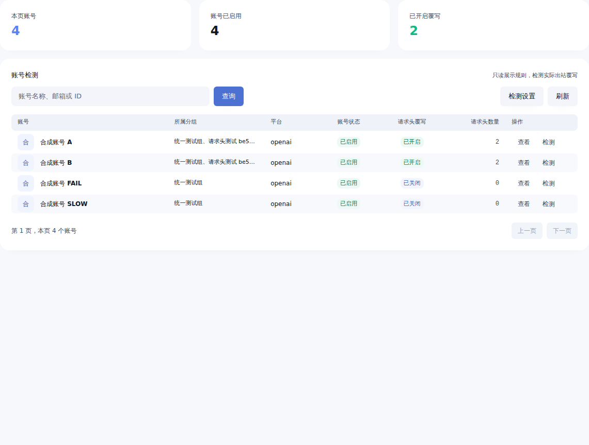
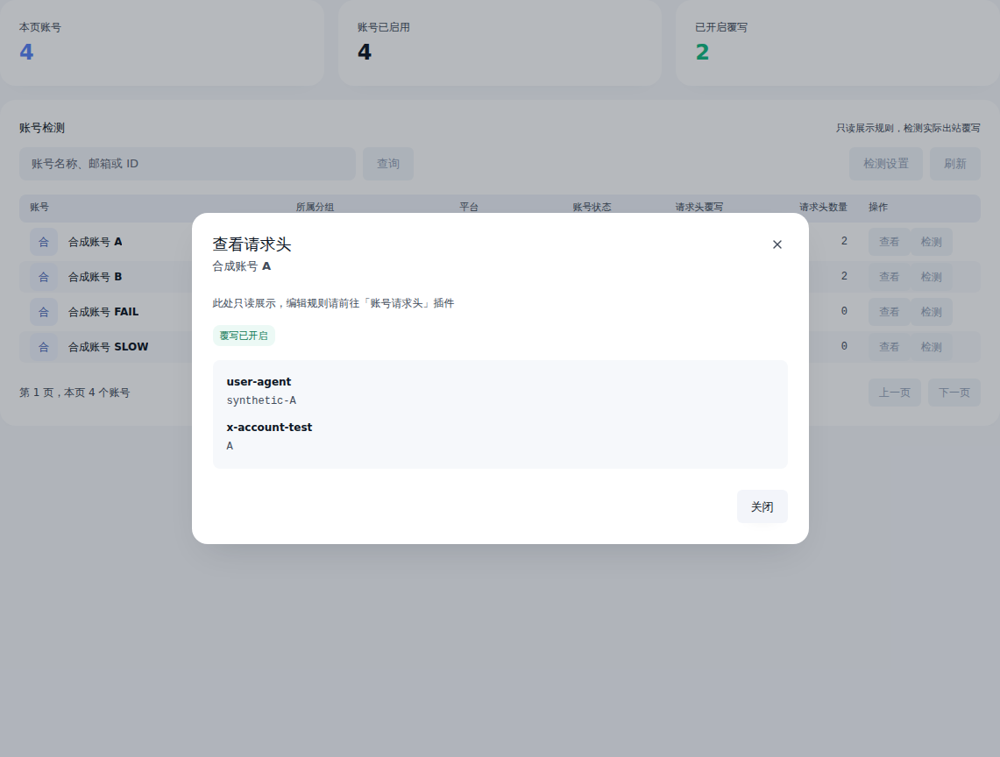
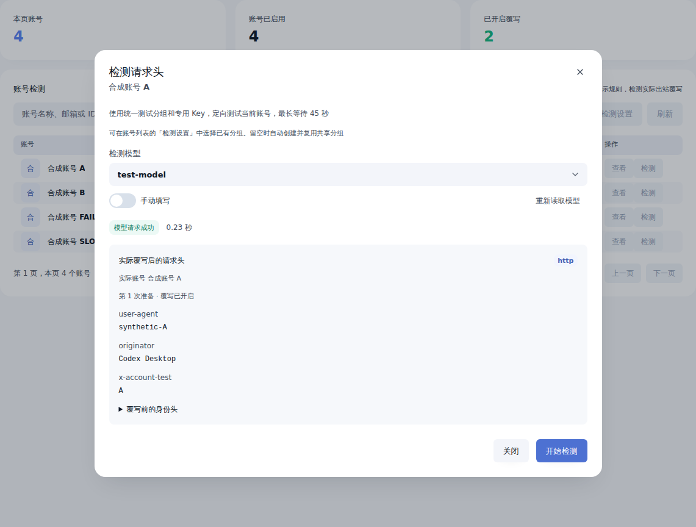
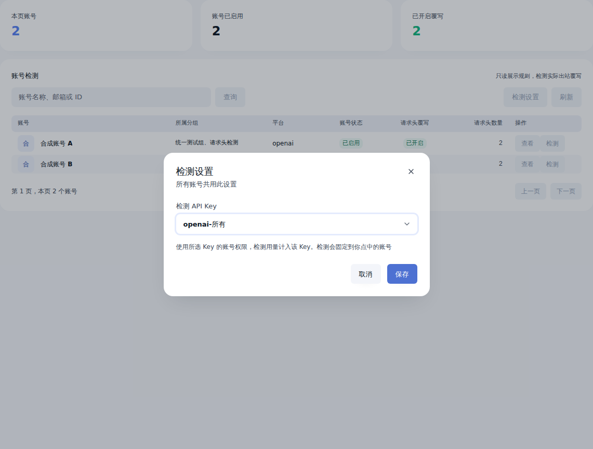

# 账号请求头检测插件

只读查看账号请求头规则，通过宿主定向模型接口验证所选账号的真实出站覆写

## 使用

1. 安装并启用 [账号请求头插件](https://github.com/SilentFlower/cpr-account-headers) v0.2.1 或以上版本，在该插件中编辑规则
2. 从 [Releases](https://github.com/SilentFlower/cpr-account-headers-test/releases/latest) 下载服务器平台对应的 `.tar.gz` 和校验文件，在 CPR 插件管理中上传并启用
3. 打开扩展页「账号请求头检测」，查看账号名称、邮箱、当前分组、覆写状态与请求头数量
4. 在「检测设置」选择已有 API Key。使用自动检测 Key 时，可选择统一分组，留空自动创建共享分组
5. 点击「查看」只读查看规则；点击「检测」，从所选账号的模型列表搜索选择模型后开始

也可使用宿主 GitHub 安装入口填写仓库 `SilentFlower/cpr-account-headers-test`，标签留空使用最新稳定版

## 定向检测

检测使用明确的账号 ID、Provider、模型 ID 与所选 Key 调用 `host.model.execute_stream`，账号资格、分组权限、租约、并发和用量仍由宿主负责。所选 Key 必须已启用并拥有目标账号权限

发起模型调用的检测插件会被宿主跳过，原「账号请求头」插件继续参与出站处理。检测前向原插件登记短期随机编号，完成后按真实模型请求 ID 收集覆写前后对照，核对实际账号与 Key。缺少真实记录时显示「尚未验证覆写」

本插件只声明管理页面能力，与会话排队迁移插件共用宿主现有调度。原插件的出站绑定须覆盖检测用的 Key、分组、平台和模型

支持 OpenAI 与 xAI 账号。模型选择读取所选账号的实际目录，支持搜索，并记住本次页面使用期间同平台的上次选择。目录之外的模型可切换为手动填写

检测最长 45 秒，支持停止和关闭弹窗取消。每个插件进程最多同时执行 4 个检测，同一账号串行执行。实际结果来自原请求头插件的处理中间件边界，其他外层插件仍可继续改写

## 分组与用量

统一设置作用于当前检测插件实例。选择已有 API Key 时，直接使用该 Key 的账号权限与用量预算。检测用量计入所选 Key

选择自动检测 Key 时，可指定统一分组。选择已有分组时，成员由管理员维护；留空时，首次检测创建一个共享分组，后续检测复用该组，并补入宿主当前全部账号

自动共享分组使用名称「请求头检测」。新建专用 Key 使用「请求头检测」或「请求头检测 · 分组名」，资源身份保存在插件私有状态中

自动模式下，每个检测分组复用一个专用 Key，模型用量计入该 Key。分组或 Key 停用、Key 范围改变及账号权限不足时会提示处理。检测资源保留供后续复用

列表与详情只读展示原插件当前保存的规则。修改请求头请进入「账号请求头」插件

## 页面

以下截图使用合成账号与请求头值



[深色主题](docs/screenshots/dark.png) · [窄屏](docs/screenshots/mobile.png)







## 兼容与构建

面向 CPR `>=3.43.0`，原请求头插件 `>=0.2.1`；使用清单 v2、RPC v7 与 `management v2`。SDK 固定到 `1a2a4a56aed0a9660f173cb1d125b9728e2f214c`，UI 固定为 `@codex-proxy/ui 0.8.0`

需要 Rust `1.99.1`、Node.js `>=24`、pnpm `12.6.0` 与对应宿主 SDK 的 `cpr-plugin`

```bash
cargo fmt --all -- --check
cargo clippy --locked --all-targets --all-features -- -D warnings
cargo test --locked
pnpm --dir frontend install --frozen-lockfile
pnpm --dir frontend lint
pnpm --dir frontend build
CPR_PLUGIN_CLI=/path/to/cpr-plugin bash scripts/package.sh
```

构建脚本默认输出 Linux x86_64 安装包及 SHA-256 文件，使用 `CPR_PLUGIN_TARGET` 指定其他已安装目标工具链

协议测试运行真实插件进程与模拟宿主回调，覆盖只读合同、模型目录、统一设置与重启、共享资源复用、定向账号及 Provider、实际请求 ID 关联、权限拒绝、错误与提前取消。集成验收使用原版宿主、独立数据库和合成上游，同时启用请求头插件、检测插件与迁移插件

## 许可证

Apache-2.0，第三方依赖许可证见 `THIRD_PARTY_LICENSES.txt`
